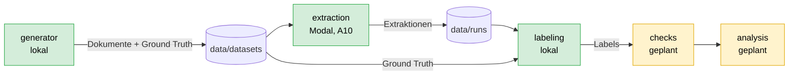

# Dokumentation

Projektdokumentation zur Bachelorarbeit *Quality-Gates für LLM-Pipelines*
(Halluzinationserkennung bei der Extraktion deutschsprachiger Rechnungen und Verträge).

| Dokument | Inhalt |
|----------|--------|
| [architektur.md](architektur.md) | Gesamtbild: Komponenten, Datenfluss, Ausführungsorte |
| [datenmodell.md](datenmodell.md) | Ground-Truth-Schemas, Konventionen, Dateiformate |
| [generator.md](generator.md) | Erzeugung der synthetischen Dokumente |
| [extraktion.md](extraktion.md) | Prompt, Ollama, Modal-Lauf, Ausgabeformate, Protokoll, Parser |
| [labeling.md](labeling.md) | Abgleich mit der Ground Truth, Status, Fehlertypen |
| [hardware.md](hardware.md) | Warum exakt NVIDIA A10 und wie das erzwungen wird |
| [vorversuch.md](vorversuch.md) | Drei Runden, Läufe, Fehlertypen, Erkenntnisse |
| [reproduzierbarkeit.md](reproduzierbarkeit.md) | Seeds, Protokolle, Versionen |
| [entwicklung.md](entwicklung.md) | Einrichtung, Tests, Konventionen |
| [roadmap.md](roadmap.md) | Offene Bausteine und nächste Schritte |

Siehe auch: [../README.md](../README.md) (Schnellstart), [../CHANGELOG.md](../CHANGELOG.md), [../CLAUDE.md](../CLAUDE.md).

## Überblick

Grün: umgesetzt. Gelb: geplant.
