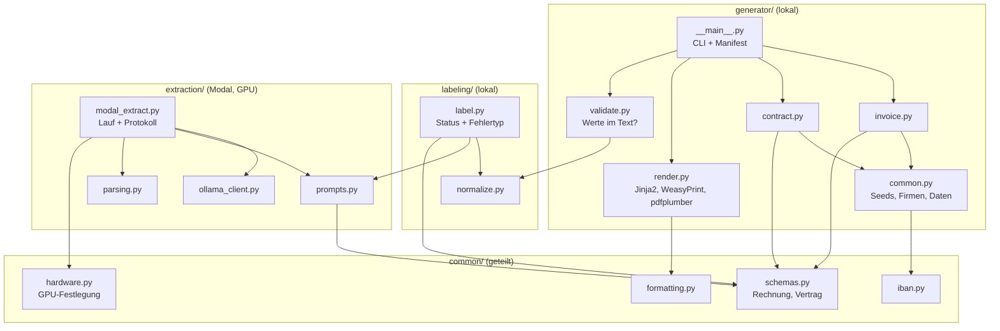
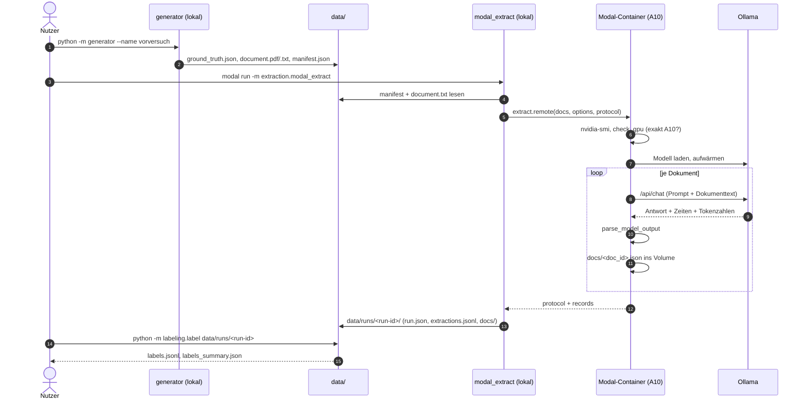
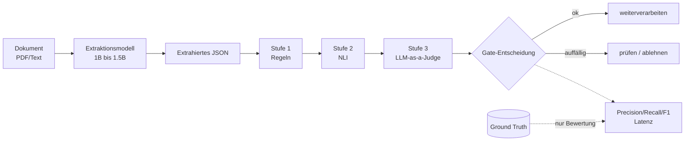

# Architektur

## Komponenten

## Datenfluss

## Wo läuft was

| Schritt | Ort | Grund |
|---------|-----|-------|
| Generator | lokal | keine Latenzmessung, braucht nur CPU |
| Extraktion | Modal, NVIDIA A10 | Latenz geht in FF3 ein, Hardware muss einheitlich sein |
| Labeling | lokal | keine Latenzmessung |
| Analyse | lokal (geplant) | keine Latenzmessung |
| Prüfstufen | Modal, NVIDIA A10 (geplant) | Latenz geht ein |

## Modal-Ressourcen

| Ressource | Name | Zweck |
|-----------|------|-------|
| App | `ba-extraktion` | Funktion `extract` (GPU `A10`, Timeout 2 h) |
| Volume | `ba-ollama-models` | Modell-Cache (`/models`), Download nur einmal |
| Volume | `ba-results` | Zwischenergebnisse und Wiederaufnahme (`/results`) |

Das Image basiert auf `debian_slim` (Python 3.12) mit installiertem Ollama; `extraction` und `common`
werden als lokale Python-Quellen eingebunden.

## Zielbild der Gesamtpipeline

Die Prüfstufen sind geplant (Stand: nicht implementiert) und dürfen die Ground Truth nie sehen.
