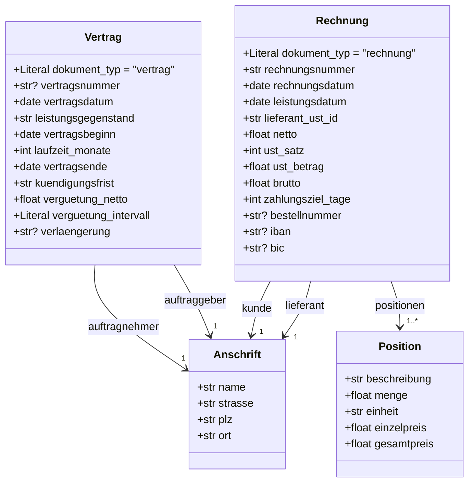
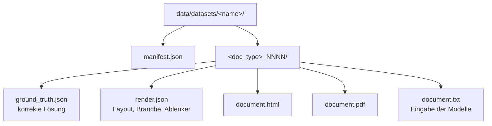
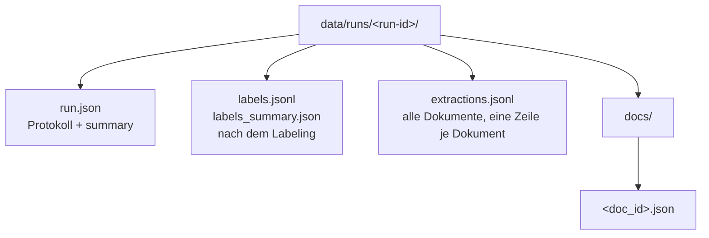

# Datenmodell

Definiert in [`common/schemas.py`](../common/schemas.py) (Pydantic v2, `extra="forbid"`).
Die Ground Truth ist die korrekte Lösung je Dokument. Sie wird nur zur Erzeugung und späteren Bewertung
genutzt, nie von den Prüfstufen.

## Klassendiagramm

`verguetung_intervall` ist `"monatlich"`, `"vierteljährlich"` oder `"jährlich"`.

## Konventionen

| Aspekt | Festlegung |
|--------|-----------|
| Datum | ISO `YYYY-MM-DD` |
| Beträge | Zahl in Euro, zwei Nachkommastellen |
| Steuersatz | ganze Prozentzahl (19, 7, 0) |
| Fehlendes optionales Feld | `null` |

## Optionale Feldgruppen

Jede Gruppe fehlt **unabhängig** von den anderen bei einem festen Anteil der Dokumente (Standard 30 %,
genau `n * rate` kaufmännisch gerundet je Typ und Gruppe, eigener Seed je Gruppe). Damit hat etwa die Hälfte der
Dokumente mindestens eine Lücke. Definiert in `OPTIONAL_GROUPS` (`common/schemas.py`):

| Dokumenttyp | Gruppe | Felder |
|-------------|--------|--------|
| Rechnung | `bank` | `iban`, `bic` |
| Rechnung | `bestellnummer` | `bestellnummer` |
| Vertrag | `verlaengerung` | `verlaengerung` (Klausel fehlt) |
| Vertrag | `vertragsnummer` | `vertragsnummer` |

Fehlende Werte sind die Gelegenheit für extrinsische Halluzinationen: Ein Modell, das hier etwas einsetzt statt
`null` zu liefern, fällt auf (Fehlertyp `erfunden`, siehe [labeling.md](labeling.md)).
`vertragsnummer` steht im Schema vorne, ist aber optional (`Optional[str]` ohne Standardwert).

## Interne Konsistenz der Ground Truth

Getestet in `tests/test_generator.py`:

- Summe der Positionen = Netto; Netto + USt = Brutto (Berechnung mit `Decimal`, kaufmännisch gerundet).
- IBANs sind rechnerisch gültig (Prüfziffer), gehören aber zu keinem echten Konto.
- Vertragsbeginn ist immer ein Monatserster; Vertragsende = Beginn + Laufzeit − 1 Tag; Vertragsdatum liegt vor dem Beginn.
- Leistungsdatum ≤ Rechnungsdatum; Lieferant ≠ Kunde, Auftraggeber ≠ Auftragnehmer (Name und Ort verschieden).
- Ausgewählte Ground-Truth-Werte (Nummern, Beträge, USt-ID, BIC) stehen tatsächlich im erzeugten Dokument.
- Gleicher Seed erzeugt identische Ground Truth.
- Jeder Ground-Truth-Wert ist im Dokumenttext auffindbar; sonst bricht der Generator ab (`generator/validate.py`).

## Dateiformate

### Datensatz `data/datasets/<name>/`

`manifest.json` enthält Name, Zeitstempel, Seed, Anzahl je Typ, `missing_rate`, Generatorversion,
Git-Commit, Python- und Paketversionen sowie je Dokument `doc_id`, `seed`, `layout`,
`fehlende_gruppen` und `fehlende_felder`.

### Lauf `data/runs/<run-id>/`

Ein Dokument-Datensatz enthält: `doc_id`, `doc_type`, `run_id`, `model`, `gpu`, `raw_output`,
`parsed`, `parse_error`, `done_reason`, `wall_ms`, `total_ms`, `load_ms`, `prompt_eval_ms`, `eval_ms`,
`prompt_tokens`, `completion_tokens`, `created_at`.

`labels.jsonl` hat einen Eintrag je Feld: `run_id`, `doc_id`, `doc_type`, `field`, `gt`, `extracted`, `status`, `fehlertyp`, `detail`.

Die Run-ID lautet `<YYYYMMDD-HHMM>_<datensatz>_<modell>_t<temperature>_s<seed>`, z. B.
`20261103-1526_vorversuch_qwen2.5-1.5b_t0_s42`.
