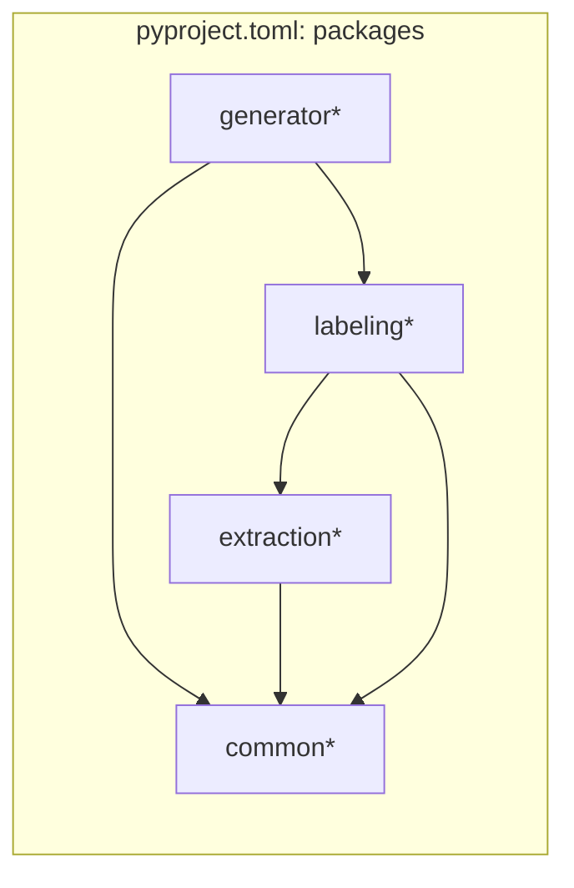
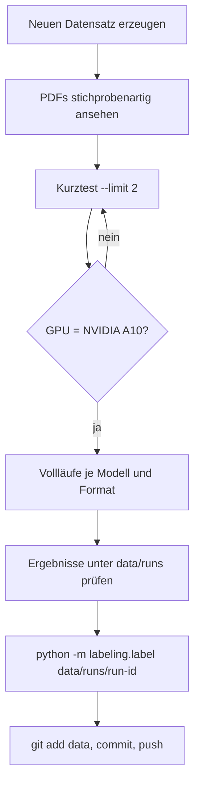

# Entwicklung

## Einrichtung

```bash
# WeasyPrint braucht Pango (Ubuntu)
sudo apt install libpango-1.0-0 libpangoft2-1.0-0 fonts-dejavu

python3 -m venv .venv
source .venv/bin/activate
pip install -e ".[modal,dev]"

modal setup        # Browser öffnet sich, Token wird lokal gespeichert
pytest
```

Python ≥ 3.11 (entwickelt mit 3.12.3). Abhängigkeiten: `faker`, `jinja2`, `weasyprint`, `pdfplumber`,
`pydantic`; optional `modal` und `pytest`.

## Tests

`pytest` (Konfiguration in `pyproject.toml`, Ordner `tests/`). Die Tests brauchen weder Modal noch GPU.

| Datei | Prüft |
|-------|-------|
| `test_common.py` | IBAN-Prüfziffer und -Erzeugung, Formatierung |
| `test_generator.py` | Rechen- und Vertragslogik, Reproduzierbarkeit, fester Anteil fehlender Felder |
| `test_extraction.py` | Parser (reines JSON, Codeblock, Text drumherum, unbrauchbar), Prompt, Schemahinweise, Prompt-Hash |
| `test_hardware.py` | GPU-Prüfung, Hardwarewechsel, Konsistenz |
| `test_labeling.py` | Normalisierung, Status, Fehlertypen, Anschrift als Einheit |
| `test_validate.py` | Auffindbarkeit der Ground-Truth-Werte im Dokumenttext |

## Paketstruktur



`checks`, `experiments` und `analysis` müssen beim Anlegen in `[tool.setuptools.packages.find] include` ergänzt werden.

## Konventionen

- Deutsch für Text, Kommentare und Commit-Messages; Bezeichner ohne Umlaute.
- Commit-Messages: Betreffzeile + Begründung im Rumpf.
- Ergebnisse (`data/`) werden committet: `git add data && git commit`.
- Änderungen mit Außenwirkung gehören in [../CHANGELOG.md](../CHANGELOG.md).
- Neue Modal-Funktionen verwenden `MODAL_GPU` aus `common/hardware.py` und rufen `check_gpu` vor dem Modell-Download auf.

## Typische Arbeitsabläufe



## Prompt ändern

1. `extraction/prompts.py` anpassen.
2. `PROMPT_VERSION` erhöhen.
3. `pytest tests/test_extraction.py` laufen lassen.
4. Neue Läufe starten, alte nicht überschreiben.
5. Changelog ergänzen.
