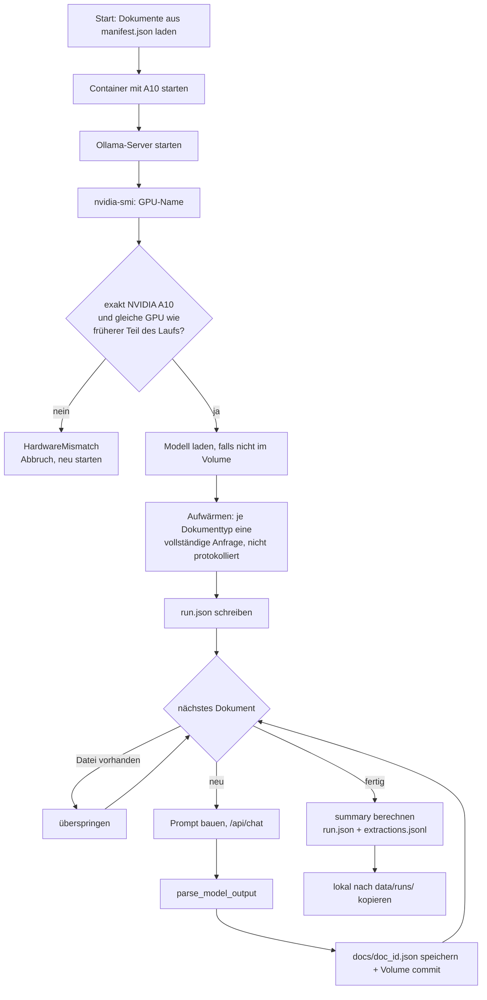

# Extraktion

Kleine Sprachmodelle (Llama 3.2 1B, Qwen2.5 1.5B) lesen den Dokumenttext und liefern ein JSON nach dem
Zielschema. Das Ergebnis sind die Rohdaten, an denen später Halluzinationen erkannt werden sollen.
Code: [`extraction/`](../extraction/).

## Aufruf

```bash
# Kurztest (2 Dokumente)
modal run -m extraction.modal_extract --dataset data/datasets/vorversuch --model llama3.2:1b --limit 2

# Vollläufe
modal run -m extraction.modal_extract --dataset data/datasets/vorversuch --model llama3.2:1b
modal run -m extraction.modal_extract --dataset data/datasets/vorversuch --model qwen2.5:1.5b --fmt schema_text
```

| Option | Standard | Bedeutung |
|--------|----------|-----------|
| `--model` | `llama3.2:1b` | Ollama-Modell; Ausweich `qwen3:1.7b` (Denkmodus wird abgeschaltet) |
| `--limit` | 0 (alle) | nur die ersten n Dokumente |
| `--doc-type` | `all` | `rechnung` oder `vertrag` |
| `--temperature` | 0 | Hauptlauf 0, Stabilitätstest 0.7 |
| `--seed` | 42 | Ollama-Seed |
| `--fmt` | `none` | `none` (freie Antwort), `json` (JSON-Modus), `schema` (Structured Output mit Datentypen), `schema_text` (feste Felder, Werte als Text) |
| `--num-ctx` | 8192 | Kontextfenster |
| `--num-predict` | 1024 | maximale Antwortlänge (vollständige Antwort ca. 500 Tokens) |
| `--run-id` | automatisch | gleiche ID erneut = Wiederaufnahme |

## Ablauf eines Laufs



Die GPU wird vor dem Modell-Download geprüft, damit bei falscher Karte weder Zeit noch Guthaben verbraucht wird.

## Prompt (`extraction/prompts.py`)

- Version `PROMPT_VERSION = "v3"`, Hash über System-Prompt, Template und Schemahinweise (`prompt_hash()`, aktuell `214d65bf415a`).
- Versionen: v1 (`a40384e7a2f8`) mit Beispielwerten, v2 (`cd6d3cf6a64d`) ohne Beispielwerte, v3 (`214d65bf415a`) mit Feld `bestellnummer` und optionaler `vertragsnummer`.
- System: Datenextraktionssystem, antwortet nur mit gültigem JSON.
- User: Regeln (nur Werte aus dem Dokument, sonst `null`; ISO-Datum; Zahlen mit Punkt), Zielschema, Dokument zwischen `<<<` und `>>>`.
- v1 enthielt Beispielwerte („2 Wochen zum Monatsende“, „automatisch um 3 Monate“), die die Modelle häufig wörtlich übernahmen
  (Qwen: Verlängerung in 10 von 10 Verträgen). Ab v2 beschreiben die Hinweise nur noch die Form. `PROMPT_BEISPIELE` bleibt erhalten,
  damit das Labeling v1-Läufe kennzeichnen kann.
- **Jede inhaltliche Änderung erhöht `PROMPT_VERSION`.**

## Ausgabeformate

| `--fmt` | Ollama-Parameter | Zweck |
|---------|------------------|-------|
| `none` | kein `format` | Standard; zeigt, wie gut Modelle ohne Hilfe liefern |
| `json` | `format: "json"` | erzwingt syntaktisch gültiges JSON |
| `schema` | `format: <JSON-Schema>` | erzwingt Struktur und Datentypen (aus den Pydantic-Modellen, ohne `dokument_typ`) |
| `schema_text` | `format: <JSON-Schema>` | erzwingt feste Feldnamen und Reihenfolge, alle Werte bleiben Text oder `null`. Verhindert Wiederholungsschleifen und erfundene Felder, ohne Zahlen- und Datumsformate zu erzwingen; die Normalisierung übernimmt das Labeling |

## Parser (`extraction/parsing.py`)

Toleriert Markdown-Codeblöcke und Text vor dem JSON. Alles andere zählt als **unbrauchbar** und wird mit
Fehlertext protokolliert: `leere Antwort`, `kein JSON-Objekt gefunden`, `ungültiges JSON: …`,
`JSON ist kein Objekt, sondern …`.

## Protokoll

`run.json` (Auszug der Felder): `run_id`, `dataset`, `options`, `output_format`, `prompt_version`,
`prompt_hash`, `gpu_requested`, `git_commit`, `model` (Digest, Größe, Familie, Parametergröße,
Quantisierung), `environment` (Ollama-Version, GPU, Treiber, GPU-Speicher, CPUs, Modal-Region und -Cloud),
`started_at`, `finished_at`, `summary`.

`summary`: `n_docs`, `n_unbrauchbar`, `anteil_unbrauchbar`, `latenz_median_ms`, `latenz_max_ms`.

Latenzfelder je Dokument: `wall_ms` (gemessen im Container), `total_ms`, `load_ms`, `prompt_eval_ms`,
`eval_ms` (von Ollama), dazu `prompt_tokens`, `completion_tokens`, `done_reason`.

## Abbruch und Wiederaufnahme

Ergebnisse je Dokument liegen im Modal-Volume `ba-results`. Wird derselbe Lauf mit derselben `--run-id`
erneut gestartet, werden vorhandene Dokumente übersprungen. Die GPU muss dabei dieselbe sein.

Ohne offenes Terminal:

```bash
modal run --detach -m extraction.modal_extract --dataset ... --model ... --run-id meinlauf
modal volume get ba-results meinlauf data/runs/
```

## Aufwärmen

Vor der Messung stellt das Skript je Dokumenttyp eine vollständige, echte Anfrage (nicht protokolliert). Ein Aufwärmen mit
nur einem Token reichte nicht: Das erste gemessene Dokument war 3- bis 4-mal langsamer als die folgenden.

## Offene Punkte

- `OLLAMA_VERSION` ist noch nicht fixiert (`None` = aktuelle Version); nach dem Vorversuch festlegen.
