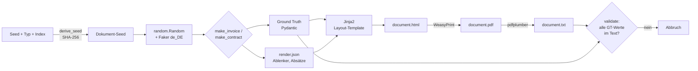

# Generator

Erzeugt synthetische deutsche Rechnungen und Dienstleistungsverträge samt Ground Truth.
Läuft lokal, braucht keine GPU.

```bash
python -m generator --name vorversuch --n-rechnung 10 --n-vertrag 10 --seed 42
```

| Option | Standard | Bedeutung |
|--------|----------|-----------|
| `--name` | (Pflicht) | Name des Datensatzes, Ordner unter `--out` |
| `--n-rechnung` / `--n-vertrag` | 10 / 10 | Anzahl je Dokumenttyp |
| `--seed` | 42 | Gesamtseed |
| `--missing-rate` | 0.3 | Anteil der Dokumente, denen jeweils eine optionale Feldgruppe fehlt (je Gruppe unabhängig) |
| `--out` | `data/datasets` | Zielordner |
| `--no-pdf` | aus | nur JSON und HTML, zum schnellen Testen |

## Pipeline



`document.txt` ist genau der Text, den die Modelle bekommen (alle Seiten, durch Leerzeilen getrennt).

## Reproduzierbarkeit

- Jedes Dokument hat einen eigenen Seed: `derive_seed(seed, doc_type, index)` (SHA-256, unabhängig von der
  Python-Hash-Randomisierung). Derselbe Gesamtseed ergibt dieselbe Ground Truth.
- Die Auswahl der Dokumente ohne eine optionale Feldgruppe ist fest: genau `n * rate` (kaufmännisch gerundet) je Typ und Gruppe, gezogen mit eigenem Seed je Gruppe. Die Gruppen sind unabhängig, sodass Lücken in verschiedenen Kombinationen auftreten.
- `manifest.json` hält Parameter, Paketversionen und Git-Commit fest.

## Rechnungen (`generator/invoice.py`)

- Branchen: IT-Dienstleistungen, Büro- und Geschäftsbedarf, Handwerk, Catering mit je eigenem Positionskatalog (1 bis 5 Positionen).
- USt 19 %; 7 % nur bei Catering (in der Hälfte der Fälle, vereinfachend).
- Rechnungsnummer in vier Formaten, damit Modelle sich kein Muster merken.
- Beträge mit `Decimal`, kaufmännisch gerundet.
- **Ablenker** (stehen im Dokument, aber nicht im Schema): Kundennummer, Telefon, Ansprechpartner.
- Optionale Gruppen `bank` (`iban`, `bic`) und `bestellnummer`: fehlen sie, fehlt der Wert im Dokument und ist `null`.
- Briefkopf steht **über** der Anschrift, nicht daneben (sonst vermischte die Textextraktion Lieferant und Kunde).

## Verträge (`generator/contract.py`)

- Leistungen aus einem Katalog; Vergütungsintervall monatlich/vierteljährlich/jährlich (Gewichte 6:3:1).
- Beginn immer zum Monatsersten, Laufzeit 12/24/36 Monate; Vertragsdatum 5 bis 60 Tage vor Beginn
  (zweites Datum als **Ablenker**).
- Kündigungsfrist in der Ground Truth kanonisch (`"3 Monate zum Quartalsende"`-Muster), im Text in
  mehreren Formulierungen, Zahlen teils als Wort („drei Monaten“).
- Datumsangaben im Text zufällig kurz (`01.03.2026`) oder lang.
- Optionale Gruppen `verlaengerung` (Abschnitt „Vertragsverlängerung“ fehlt) und `vertragsnummer` (fehlt im Dokument, `null`).
- Leistungsgegenstand und Vertragsende stehen immer im Text.
- **Ablenker:** Namen der Unterzeichner.

## Layouts

Je Dokumenttyp bisher ein Layout (`rechnung_a`, `vertrag_a` in `generator/templates/`). Weitere Layouts
werden in `LAYOUTS` (`generator/render.py`) ergänzt; die Auswahl erfolgt zufällig je Dokument und wird in
`render.json` und `manifest.json` festgehalten.

## Datensatzprüfung

Nach dem Erzeugen von `document.txt` prüft `generator/validate.py`, ob jeder Ground-Truth-Wert im Text auffindbar ist
(Anschriften und Positionszeilen zusammenhängend; fehlende Felder dürfen auch nicht im Text vorkommen). Andernfalls
bricht der Generator mit `SystemExit` ab. Hintergrund: Was kein Modell finden kann, darf nicht als Halluzination zählen.

## Tests

`tests/test_generator.py` prüft Rechenlogik, Vertragslogik, IBAN-Gültigkeit, Reproduzierbarkeit, festen
Anteil fehlender Felder und die Erzeugung ohne PDF; `tests/test_validate.py` die Auffindbarkeitsprüfung.
