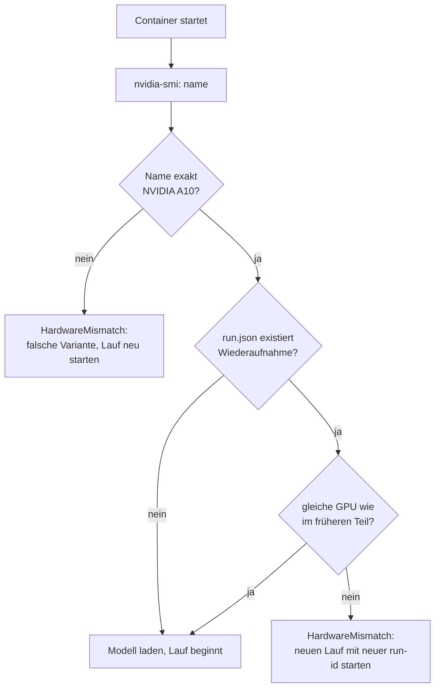

# Hardware-Festlegung

**Alle Läufe, deren Latenz in die Auswertung (FF3) eingeht, laufen auf exakt einer `NVIDIA A10`
(24 GB GDDR6, Ampere).** Das gilt für die Extraktion und für alle Prüfstufen.
Definiert in [`common/hardware.py`](../common/hardware.py).

## Das Problem

Modal bedient `gpu="A10"` je nach Cloud-Anbieter mit zwei unterschiedlichen Karten:

| `nvidia-smi`-Name | Beobachtet bei | Bemerkung |
|-------------------|----------------|-----------|
| `NVIDIA A10` | Oracle Cloud (OCI) | Zielhardware |
| `NVIDIA A10G` | AWS | andere Taktraten, Latenzen nicht vergleichbar |

Auch die Modal-Region schwankt (`us-east`, `eu-west`). Die Region wird protokolliert, ist aber nicht
festgelegt; entscheidend ist der exakte GPU-Name.

## Durchsetzung

| Funktion | Zweck |
|----------|-------|
| `check_gpu(detected, previous=None)` | Laufzeitprüfung vor dem Modell-Download; verhindert Hardwarewechsel bei Wiederaufnahme |
| `check_runs_consistent(gpus)` | Prüfung in der Auswertung: alle Läufe/Dokumente müssen exakt `NVIDIA A10` haben |

Der GPU-Name steht im Protokoll (`run.json`, `environment.gpu`) und in jedem Dokument-Datensatz (`gpu`).

## Konsequenzen

- Landet ein Lauf auf einer A10G, bricht er sofort ab und wird neu gestartet. Es entstehen keine Teilergebnisse auf falscher Hardware.
- Bestehende Läufe auf anderer Hardware bleiben als Dokumentation im Repo, gehen aber nicht in Latenzvergleiche ein
  (siehe [vorversuch.md](vorversuch.md)).
- Die Konstanten `MODAL_GPU` und `EXPECTED_GPU_NAME` nicht ändern, ohne alle betroffenen Läufe zu wiederholen.

## Tests

`tests/test_hardware.py`: akzeptiert `NVIDIA A10`; lehnt `A10G`, `T4`, `L4` und `None` ab; lehnt
Hardwarewechsel bei Wiederaufnahme ab; Konsistenzprüfung für die Auswertung.
