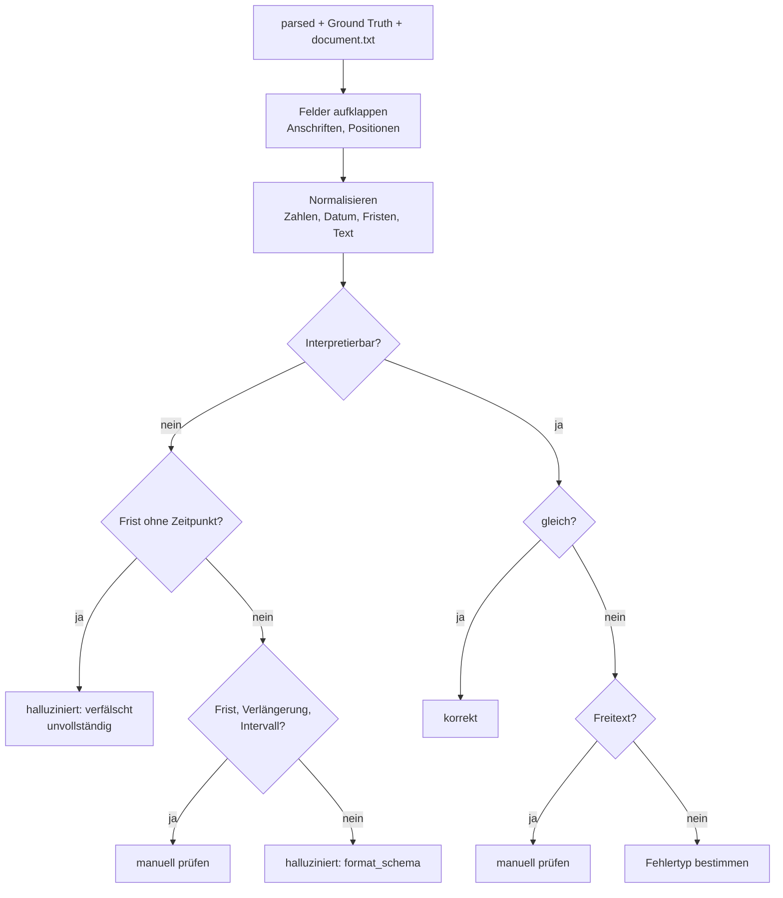
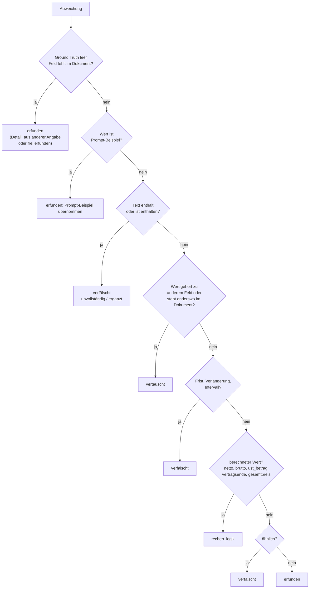

# Labeling

Vergleicht die Extraktionen feldweise mit der Ground Truth und vergibt je Feld einen Status und, bei
Abweichungen, einen vorgeschlagenen Fehlertyp. Die Labels sind die Referenz für die späteren Prüfstufen
(Precision/Recall/F1). Läuft lokal. Code: [`labeling/label.py`](../labeling/label.py),
[`labeling/normalize.py`](../labeling/normalize.py).

```bash
python -m labeling.label data/runs/<run-id> [weitere Läufe ...]
python -m labeling.label data/runs/<run-id> --adressen-einzeln   # Vergleichszählung, eigene Dateien
```

Ausgabe je Lauf: `labels.jsonl` (ein Eintrag je Feld) und `labels_summary.json`
(gesamt, je Dokumenttyp, je Fehlertyp, je Feld).

## Ablauf je Dokument



## Status

| Status | Bedeutung |
|--------|-----------|
| `korrekt` | stimmt nach Normalisierung überein |
| `halluziniert` | weicht ab; jede Abweichung gilt als Halluzination |
| `manuell_pruefen` | automatisch nicht entscheidbar (Freitext wie `leistungsgegenstand`, nicht interpretierbare Frist, Verlängerung oder Intervall) |

## Fehlertypen (Heuristik)



| Fehlertyp | Art | Bedeutung |
|-----------|-----|-----------|
| `erfunden` | extrinsisch | Wert ohne Beleg im Dokument. Jeder Wert für ein Feld, das im Dokument nicht existiert, zählt dazu, auch wenn er aus einer anderen Angabe stammt (z. B. USt-IdNr. als IBAN). Auch zusätzliche Positionen. |
| `verfaelscht` | intrinsisch | Wert steht nicht im Dokument, ähnelt aber dem korrekten (z. B. Ziffernvertauschung, anderes Datum mit zwei gleichen Teilen) |
| `vertauscht` | intrinsisch | Feld existiert, erhält aber den Wert eines anderen Felds oder einer anderen Stelle im Dokument |
| `rechen_logik` | – | berechneter Wert falsch und nicht im Dokument |
| `format_schema` | – | Feld fehlt in der Ausgabe, wurde fälschlich mit `null` ausgelassen oder ist nicht als Feldtyp interpretierbar |

Die Taxonomie ist eine Heuristik und wird anhand der beobachteten Fehler verfeinert; Grenzfälle werden manuell geprüft.

## Normalisierung (`normalize.py`)

Formatabweichungen sind keine Halluzinationen. Vor dem Vergleich werden vereinheitlicht:

- Text: Kleinschreibung, Leerzeichen und Anführungszeichen (NFKC).
- Zahlen: deutsche und englische Schreibweise, Währungszeichen; Kommas als Tausendertrenner
  (`2,723,04 €` wird 2723.04 und gilt als Formatfehler, nicht als Halluzination).
- Daten: ISO, `TT.MM.JJJJ`, ausgeschriebene Monate.
- Kündigungsfrist, Verlängerung, Intervall: Zahlwörter und Ziffern, Dauer und Bezugszeitpunkt.
- Leerwerte: `"null"`, `"keine"`, `"-"`, `"n/a"` usw. gelten als leer.

## Bewertungseinheit Anschrift

Eine Anschrift (Name, Straße, PLZ, Ort) zählt als **ein** Feld und ist nur korrekt, wenn alle vier Teile stimmen.
Sonst würde eine vertauschte Zuordnung von Lieferant und Kunde als acht Fehler gezählt. Ist die ganze
Anschrift die einer anderen, lautet der Fehlertyp `vertauscht`; sonst gilt der häufigste Teilfehler (bei Gleichstand
nach Priorität: erfunden, vertauscht, verfälscht, rechen_logik, format_schema). Die Teilfelder stehen im Feld `detail`.
Mit `--adressen-einzeln` entsteht zum Vergleich die feldweise Zählung (`labels_adressen_einzeln*.json(l)`).

## Datensatzprüfung (`generator/validate.py`)

Gegenstück auf der Datenseite: Der Generator bricht ab, wenn ein Ground-Truth-Wert im Dokumenttext nicht
auffindbar ist (Anschriften und Positionszeilen werden zusammenhängend geprüft). So wird kein Modell für etwas
bestraft, das im Text gar nicht steht, und ein Abbruch weist auf einen Fehler im Layout hin.

## Tests

`tests/test_labeling.py` (Normalisierung, Fehlertypen, Anschriften) und `tests/test_validate.py`.
