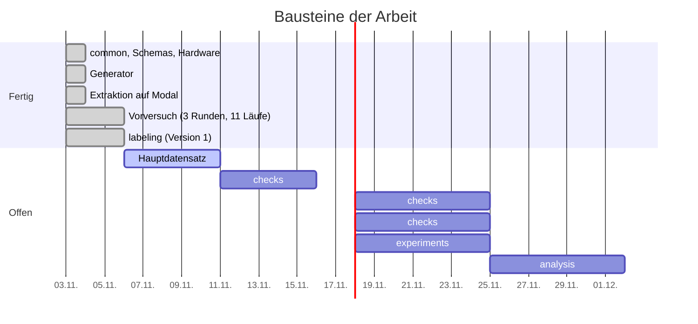

# Roadmap

Stand: 2026-11-06. Abgeleitet aus der Bausteintabelle im [README](../README.md).

Die Dauern sind Platzhalter zur Orientierung, keine Terminzusage.

| Baustein | Aufgabe | Läuft auf | Stand |
|----------|---------|-----------|-------|
| `labeling/` | Abgleich Extraktion ↔ Ground Truth, Status und Fehlertypen ([labeling.md](labeling.md)) | lokal | fertig (Heuristik wird verfeinert) |
| `checks/` | Prüfstufen: Regeln, NLI, LLM-as-a-Judge | Modal (A10) | offen |
| `experiments/` | Modal-Skripte für Einzel- und Kombinationsläufe der Prüfstufen | Modal (A10) | offen |
| `analysis/` | Precision/Recall/F1, Bootstrap-Konfidenzintervalle, Plots, Latenz | lokal | offen |

## Nächste Schritte

1. Manuelle Prüfung der `manuell_pruefen`-Felder und Grenzfälle der Fehlertypen; Taxonomie ggf. verfeinern.
2. Entscheidung über Ausgabeformat und Prompt im Hauptlauf. Bisher spricht die Datenlage für `schema_text`
   (alle Antworten parsbar, siehe [vorversuch.md](vorversuch.md)); Qwen2.5 1.5B schneidet besser ab als Llama 3.2 1B.
3. Ollama-Version fixieren (`OLLAMA_VERSION` in `extraction/modal_extract.py`).
4. Hauptdatensatz mit mehr Dokumenten und weiteren Layouts erzeugen (`LAYOUTS` in `generator/render.py`).
5. Stabilitätstest mit Temperature 0.7.
6. Prüfstufen implementieren und einzeln sowie kombiniert auf der A10 messen.

## Offene Entscheidungen

- Ausweichmodell `qwen3:1.7b`, falls ein Hauptmodell nicht taugt (Denkmodus ist bereits abgeschaltet).
- Umfang des Hauptdatensatzes und Anzahl der Layouts je Dokumenttyp.
- Umgang mit Region/Cloud-Wechseln der A10 (bisher nur protokolliert).
