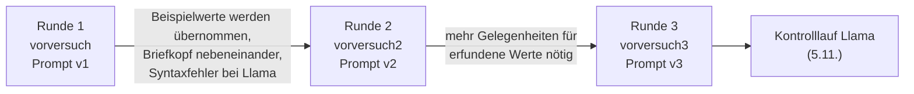

# Vorversuch

Ziel: prüfen, ob die Pipeline Ende zu Ende funktioniert, ob die kleinen Modelle verwertbare Antworten
liefern und wie die Fehler aussehen, bevor der Hauptdatensatz erzeugt wird. Der Vorversuch lief in
**drei Runden** (2026-11-03 bis 2026-11-05), jede Runde mit angepasstem Prompt oder Datensatz.

Je Datensatz 10 Rechnungen und 10 Verträge, Seed 42, Ordner `data/datasets/`.



| Runde | Datensatz | Lücken (`missing_rate`) | Prompt | Änderungen davor |
|-------|-----------|-------------------------|--------|------------------|
| 1 | `vorversuch` | 25 %, eine gemeinsame Lücke je Dokument | v1 | – |
| 2 | `vorversuch2` | 25 % | v2 (`cd6d3cf6a64d`) | Prompt ohne konkrete Beispielwerte; Briefkopf über statt neben der Anschrift; Generator prüft Auffindbarkeit der Werte; Labeling eingeführt |
| 3 | `vorversuch3` | 30 % je Feldgruppe, unabhängig | v3 (`214d65bf415a`) | neue optionale Felder `bestellnummer` und `vertragsnummer`; Aufwärmen mit echten Anfragen |

## Läufe

Alle mit Temperature 0, Seed 42, `num_ctx` 8192, `num_predict` 1024 (Ausnahme Probelauf 1416: 2048).
„Unbrauchbar“ heißt nicht parsbar; „Felder halluziniert“ stammt aus dem Labeling
(Anschrift = ein Feld, siehe [labeling.md](labeling.md)). Run-ID: `data/runs/20261103-HHMM_<datensatz>_<modell>_t0_s42/`
(Lauf 7 am 05.11.).

| Nr. | Lauf | Modell | Format | Prompt | GPU | unbrauchbar | Felder halluziniert | Latenz Median | für Latenz gültig |
|-----|------|--------|--------|--------|-----|-------------|---------------------|---------------|-------------------|
| – | 1416 `vorversuch` | llama3.2:1b | none | v1 | **L4** | 2 von 2 | – | 16 459 ms | nein |
| 1 | 1517 `vorversuch` | llama3.2:1b | none | v1 | **A10G** | 8 von 20 | 56 von 240 (23,3 %) | 1 777 ms | nein |
| 2 | 1519 `vorversuch` | qwen2.5:1.5b | none | v1 | A10 | 0 | 84 von 500 (16,8 %) | 1 449 ms | ja |
| 3 | 1524 `vorversuch` | llama3.2:1b | schema | v1 | A10 | 0 | 163 von 500 (32,6 %) | 1 379 ms | ja |
| 4 | 1526 `vorversuch` | qwen2.5:1.5b | schema | v1 | A10 | 0 | 89 von 500 (17,8 %) | 1 522 ms | ja |
| 5 | 1554 `vorversuch2` | llama3.2:1b | none | v2 | A10 | 9 von 20 | 37 von 160 (23,1 %) | 1 301 ms | ja |
| 6 | 1558 `vorversuch2` | llama3.2:1b | json | v2 | A10 | 3 von 20 | 64 von 354 (18,1 %) | 1 342 ms | ja |
| 7 | 1602 `vorversuch2` | qwen2.5:1.5b | json | v2 | A10 | 0 | 50 von 390 (12,8 %) | 1 469 ms | ja |
| 8 | 1641 `vorversuch2` | qwen2.5:1.5b | schema_text | v2 | A10 | 0 | 50 von 390 (12,8 %) | 1 463 ms | ja |
| 9 | 1644 `vorversuch2` | llama3.2:1b | schema_text | v2 | A10 | 0 | 74 von 390 (19,0 %) | 1 263 ms | ja |
| 10 | 1714 `vorversuch3` | qwen2.5:1.5b | schema_text | v3 | A10 | 0 | 52 von 390 (13,3 %) | 1 454 ms | ja |
| 11 | 05.11. 1420 `vorversuch3` | llama3.2:1b | schema_text | v3 | A10 | 0 | 79 von 390 (20,3 %) | 1 283 ms | ja |

Die Zahl der bewerteten Felder unterscheidet sich, weil unbrauchbare Dokumente nicht gelabelt werden
(Lauf 1, 5, 6) und weil die Datensätze verschiedene Felder haben.
Die Raten sind nicht über Prompts und Datensätze hinweg direkt vergleichbar.

## Fehlertypen (Labeling, Anzahl Felder)

| Lauf | vertauscht | erfunden | verfälscht | rechen_logik | format_schema |
|------|-----------:|---------:|-----------:|-------------:|--------------:|
| 3 Llama, schema, v1 | 58 | 61 | 21 | 23 | – |
| 4 Qwen, schema, v1 | 63 | 14 | 9 | 1 | 2 |
| 9 Llama, schema_text, v2 | 30 | 10 | 24 | – | 10 |
| 8 Qwen, schema_text, v2 | 29 | – | 15 | – | 6 |
| 11 Llama, schema_text, v3 | 35 | 14 | 26 | – | 4 |
| 10 Qwen, schema_text, v3 | 24 | 1 | 14 | – | 13 |

Die Zahlen stammen aus der aktuellen Version des Labelings (Stand 05.11.); frühere Labels wurden mehrfach neu
berechnet, siehe Changelog. Der Fehlertyp ist eine Heuristik.

## Erkenntnisse

1. **Syntaxfehler bei Llama 3.2 1B:** ohne Formatbindung 8 von 20 (Runde 1) bzw. 9 von 20 (Runde 2) Antworten
   unbrauchbar. Ursache sind Wiederholungsschleifen, die am Tokenlimit abgeschnitten werden. Der reine JSON-Modus
   (`json`) beseitigt das nur teilweise (3 von 20). `schema` und `schema_text` liefern 20 von 20 parsbare Antworten.
2. **`schema` (mit Datentypen) schnitt bei Llama am schlechtesten ab:** höchste Rate in Runde 1 (32,6 %),
   darunter 23 `rechen_logik`-Fehler. Daraufhin wurde `schema_text` eingeführt: feste Feldnamen und Reihenfolge,
   Werte als Text, kein Zwang zur Umwandlung deutscher Zahlen- und Datumsformate; die Normalisierung übernimmt das Labeling.
3. **Prompt-Artefakt in v1:** Die Modelle übernahmen die Beispielwerte („2 Wochen zum Monatsende“, „automatisch um
   3 Monate“) wörtlich, bei Qwen in 10 von 10 Verträgen. Das ist keine natürliche Halluzination; v2 beschreibt nur noch die Form.
4. **Datensatzfehler:** Nebeneinanderstehende Briefkopf-Blöcke wurden bei der Textextraktion zeilenweise vermischt,
   Lieferant und Kunde ließen sich nicht trennen. Der Generator setzt den Briefkopf jetzt über die Anschrift und
   bricht ab, wenn ein Ground-Truth-Wert nicht im Text steht (`generator/validate.py`).
5. **Erfundene Werte brauchen Lücken:** Erst die Felder, die im Dokument fehlen können, ermöglichen
   „extrinsische“ Halluzinationen. Runde 3 erweitert sie (Bestellnummer, Vertragsnummer) und lost jede Gruppe
   unabhängig aus. Wer in einer Lücke etwas einsetzt, gilt als `erfunden`, auch wenn der Wert aus einer anderen Angabe stammt.
6. **Aufwärmen:** Das erste gemessene Dokument war nach einem Aufwärmen mit nur einem Token 3- bis 4-mal langsamer
   gemessen. Seit Runde 3 wärmt je Dokumenttyp eine vollständige, echte Anfrage auf.
7. **Qwen2.5 1.5B ist stabiler** als Llama 3.2 1B (weniger Fehler, auch ohne Formatbindung parsbar).

## Einschränkungen

- Lauf 1416 (L4) und 1517 (A10G) erfüllen die Hardwarevorgabe nicht ([hardware.md](hardware.md)); die strenge
  Prüfung kam erst danach. Sie bleiben als Dokumentation im Repo, gehen aber nicht in Latenzvergleiche ein.
- Die Modal-Region wechselt (`us-east`, `eu-west`) und ist nicht festgelegt.
- 20 Dokumente je Lauf reichen für eine Funktionsprüfung, nicht für Signifikanzaussagen.
- Die Ollama-Version war nicht fixiert (alle Läufe 0.40.14).
- Lauf 8 und 7 (Qwen, `schema_text` bzw. `json`, Prompt v2) haben identische Labelzahlen; das ist plausibel,
  wurde aber nicht gesondert geprüft.

## Reproduzieren

```bash
python -m generator --name vorversuch3 --n-rechnung 10 --n-vertrag 10 --seed 42
modal run -m extraction.modal_extract --dataset data/datasets/vorversuch3 --model qwen2.5:1.5b --fmt schema_text
modal run -m extraction.modal_extract --dataset data/datasets/vorversuch3 --model llama3.2:1b --fmt schema_text
python -m labeling.label data/runs/<run-id>
```

Beachte: `vorversuch3` lässt sich nur mit dem Generatorstand ab `ca15c15` identisch erzeugen; `manifest.json`
hält den Commit fest.
